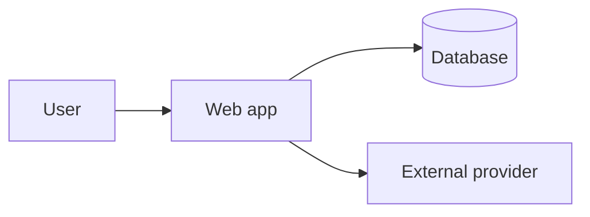
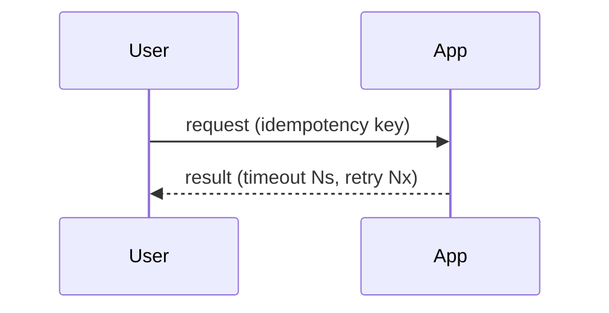

# System design: <project> (<LITE|FULL>, <why>)

Spec: specs/NNN-<name>/spec.md  Research: specs/NNN-<name>/research.md  Date: YYYY-MM-DD

## 1. Scope & numbers

Real numbers or `unknown -> Qn`. Never invent.

| Item | Value |
|------|-------|
| Users (total / active) | |
| Peak requests per second | |
| Data size per year | |
| Latency target (p95) | |
| Availability target | |
| Budget per month | |

## 2. Hosting & legal constraints

- Where each part runs (host, why).
- Contabo GTC forbids serving Syrian users: such projects go to Hetzner.
- MyContabo RAM limits: one builder at a time.

## 3. Back-of-envelope capacity

Storage, bandwidth, queue depth, AI/media API cost per unit and per month. Show the arithmetic.

## 4. Components + container diagram

One line per component: what it does, what it reuses, why anything new is new.

## 5. Data ownership & flows

| Entity | Owner component | Retention | Backup |
|--------|-----------------|-----------|--------|

System level only. Field-level model stays in Spec Kit's data-model.

## 6. Critical paths

2-3 sequence diagrams (signup, main transaction, async media job). Mark timeouts, retries, idempotency keys.

## 7. Failure modes

| Failure | Detection | Effect | Mitigation |
|---------|-----------|--------|------------|

Single points of failure: ...
Restore test: how and when a backup is restored for real.

## 8. Security & tenancy

Auth, secrets location, multi-tenant isolation, PII, rate limits.

## 9. Deploy & observability

Deploy script path, health check URL, rollback step, log location, alerts -> Telegram/Tokyo.

## 10. Decisions, questions, risks

### Decisions

| ID | Question | Options | Choice | Why | Reversible |
|----|----------|---------|--------|-----|------------|
| D1 | | | | | yes/no |

### Open questions for the owner

- Q1: ...

### Risks

- R1: ...
