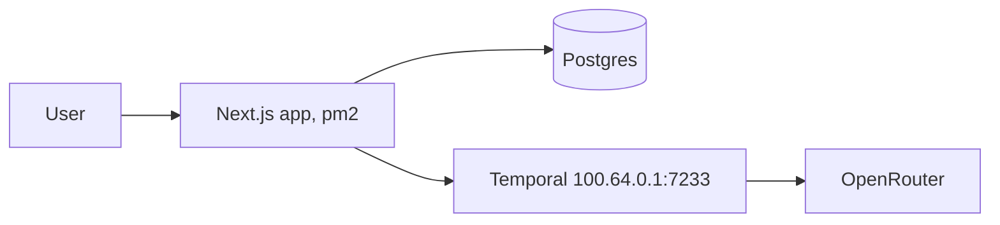
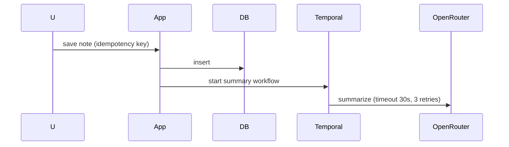

# System design: notes-app (FULL, adds a queue and an external provider)

## 1. Scope & numbers

| Item | Value |
|------|-------|
| Users | 500 total, 50 active (owner estimate) |
| Peak requests per second | 5 |
| Data size per year | unknown -> Q1 |
| Latency target (p95) | 400 ms |
| Availability target | 99.5% |
| Budget per month | 20 EUR |

## 2. Hosting & legal constraints

App and DB on MyContabo (users are in Morocco, no Syrian users). One builder at a time because of RAM.

## 3. Back-of-envelope capacity

50 users x 20 notes/day x 2 KB = 2 MB/day, about 0.7 GB/year. Summaries: 1000 calls/day x 0.002 USD = 2 USD/day.

## 4. Components + container diagram

## 5. Data ownership & flows

| Entity | Owner | Retention | Backup |
|--------|-------|-----------|--------|
| note | web app | until user deletes | nightly pg_dump |

## 6. Critical paths

## 7. Failure modes

| Failure | Detection | Effect | Mitigation |
|---------|-----------|--------|------------|
| OpenRouter down | workflow retries exhausted | no summary | show note, retry later |

Single points of failure: one host. Restore test: monthly restore of the dump to a scratch DB.

## 8. Security & tenancy

Session auth, secrets in `.env` (mode 600), rows filtered by user_id, 60 req/min/IP.

## 9. Deploy & observability

`scripts/deploy.sh`, health check `/api/health`, rollback by previous pm2 release, logs in pm2, alerts to Telegram.

## 10. Decisions, questions, risks

| ID | Question | Options | Choice | Why | Reversible |
|----|----------|---------|--------|-----|------------|
| D1 | Async summaries | inline call / Temporal | Temporal | already shared, gives retries | yes |

- Q1: expected data volume per year?
- R1: LLM cost grows with usage.
