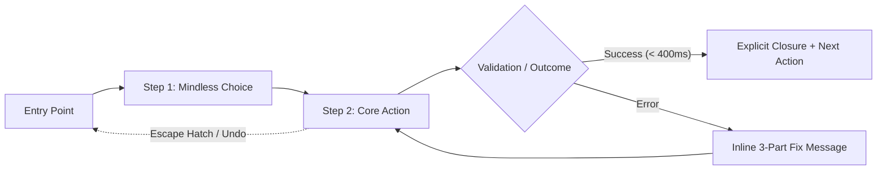

# UX Architecture — <App / System Name>

- **Mode:** LITE | FULL *(LITE = single role, <= 6 objects; FULL = multi-role, complex workflows/forms/dashboards)*
- **UX Vision (1 sentence):** <What great user experience looks like in plain language>
- **Status:** Draft | Awaiting Owner Approval | Approved
- **Linked Spec / System Design:** `<specs/NNN/spec.md>` / `<specs/NNN/system-design.md>`

<!--
Required sections:
- LITE: 1, 2, 3, 4, 5, 6, 8
- FULL: 1, 2, 3, 4, 5, 6, 7, 8
-->

## 1. Outcomes, User Archetypes & Hypotheses

### 1.1 Business & User Outcomes (Outcomes over Outputs)
- **Primary Business Metric:** <measurable leading indicator>
- **Primary User Outcome:** <time saved, errors reduced, stress removed>
- **Baseline / Current Friction:** <how users do this today>

### 1.2 Behavioral Archetypes (Perpetual Intermediates & Mainstreamers)

| Archetype | Role & Primary Goal (Why) | Context (Device, Stress, Interruptions, Language/RTL) | Frequency |
|---|---|---|---|
| <Archetype 1> | <Enduring goal> | <Desktop/Mobile, Arabic RTL / English, busy ops> | Daily |

### 1.3 Falsifiable UX Hypotheses
- **H1:** We believe `<business outcome>` will be achieved if `<archetype>` attains `<user outcome>` with `<UX approach>`.
  - **Riskiest Assumption:** <what breaks this if wrong>
  - **Cheapest Validation:** <prototype test / 3-user script / tree test>

---

## 2. Application Posture & Conceptual Model

| Surface / Module | Posture (`Sovereign` / `Transient` / `Daemonic`) | Mental Model (User's World) | Implementation Model Hidden |
|---|---|---|---|
| <Main workspace> | Sovereign | <e.g., Live Order Desk> | <e.g., 7 normalized DB tables & webhook queues> |
| <Quick action> | Transient | <e.g., 1-step Refund Slip> | <e.g., Stripe + ledger transaction> |
| <Background sync> | Daemonic | <e.g., Auto-sync badge> | <e.g., Temporal workflow retries> |

- **Core UI Idioms Chosen:** <e.g., Two-Panel Master-Detail, Slide-over Inspector, Inline Edit, `⌘K` Command Palette>
- **Ethical Agency Guarantee:** <confirm zero dark patterns, clear user control, undo/exit paths>

---

## 3. Semantic Grammar & Information Architecture

### 3.1 Object–Action–Attribute Matrix (Semantic IxD Layer 1)

| Object (Noun) | Universal Actions (Symmetrical Verbs) | Specific Actions | Summary Attributes (List) | Detail Attributes (Inspector) | Filter / Sort |
|---|---|---|---|---|---|
| <Object 1> | View, Search, Filter, Create, Edit, Archive | <e.g., Approve, Refund> | <3–5 summary fields> | <full detail groups> | <2–4 facets> |

### 3.2 Simplification Decisions (Colborne: Remove / Organize / Hide / Displace)
- **Removed:** <features/fields/choices cut from primary view>
- **Organized:** <hard-edged chunks, <= 5 items per group>
- **Hidden (Progressive Disclosure):** <advanced/expert controls + discovery cue>
- **Displaced:** <complexity moved to backend defaults or desktop vs mobile>

### 3.3 Controlled Vocabulary & Navigation Tree (IA 4 Systems)
- **Navigation Depth:** `<= 3` levels; passes Krug's Trunk Test on every deep route.
- **Global Nav (Nouns, 5–7 max):** `<Item 1> | <Item 2> | <Item 3> | ...`
- **Controlled Glossary:** `<Canonical Term> (never use <conflicting synonym>)`
- **Search & Filter Strategy:** <fields indexed, default sort, active-filter chips, empty-search recovery>

---

## 4. Critical Task Flows & Excise Eradication

### 4.1 Primary User Flow Diagram

### 4.2 Excise Eradicated
- **Navigation Excise Cut:** <e.g., Inspector drawer eliminates 3 full-page jumps>
- **Modal Excise Cut:** <e.g., Reversible actions use Undo toast instead of "Are you sure?" popups>
- **Form / Choice Excise Cut:** <e.g., Smart defaults cover 80% of cases; single-column forms>
- **Frequency Inflection:** <Top 3 daily actions 1-click / shortcut; rare actions in `•••` or Settings>

---

## 5. Inductive Screen Specs & UI Patterns

*(Repeat per primary screen / module.)*

### 5.1 Screen: `<Screen Name>`
- **Tidwell Archetype & Pattern:** <Overview / Focus / Make / Do + e.g., Two-Panel Split View>
- **Inductive Main Instruction:** `"<Explicit user-facing purpose answering: What am I supposed to do here?>"`
- **Primary CTA (Single Von Restorff Target):** `<Verb + Object>`
- **Semantic Regions (<= 3 columns):** <Left Rail / Main Stage / Right Inspector>
- **Controls & Form Rules:** <control choices matching body language, single-column forms, forgiving formats>
- **5 UI States:**
  - **Empty:** <clear value message + single primary action to create first item>
  - **Loading:** <skeleton matching final layout after 300ms>
  - **Populated:** <scannable hierarchy, <= 4–5 summary attributes per row/card>
  - **Partial / Filtered-Empty:** <active filter chips + 1-click "Clear filters">
  - **Error:** <inline 3-part error message right beside source + retry/fix button>
- **Accessibility & RTL Check:** <semantic HTML, keyboard shortcuts, color-independent status, logical CSS for Arabic/RTL>

---

## 6. Psychological Bottlenecks, Error Proofing & Latency Budgets

### 6.1 Psychological Bottlenecks Check (Evans)
- **Attention & Perception:** <foveal alert placement, Gestalt grouping, signal vs noise separation>
- **Memory:** <zero cross-screen recall; parent context visible>
- **Disposition & Motivation:** <escalating commitment in onboarding, Goal-Gradient progress, Peak–End closure>

### 6.2 Slip & Mistake Prevention Matrix (Norman)

| High-Risk Action | Error Type (Slip / Mistake) | Prevention Constraint | Recovery / Undo |
|---|---|---|---|
| <e.g., Bulk archive> | Slip (accidental click) | Distinct placement away from primary CTA | Immediate execution + 8s Undo toast |
| <e.g., Delete workspace> | Mistake (wrong scope) | Live impact preview + explicit name confirmation | Soft-delete grace period / audit log |

### 6.3 Responsiveness & Latency Budgets (Johnson + Doherty Threshold)
- `<= 100 ms`: <button press, toggle, drawer open, inline edit focus>
- `<= 400 ms`: <filter, sort, tab switch, optimistic row updates>
- `400 ms – 1 s`: <inline skeleton/busy cue preserving flow>
- `1 s – 10 s`: <determinate progress + cancel button>
- `> 10 s`: <Daemonic background job + completion notification>

---

## 7. Analytics & UX Instrumentation *(Required in FULL mode)*

| Funnel / Event Name | Trigger | UX Question It Answers |
|---|---|---|
| `<flow_started>` | User opens primary flow | Entry volume & discovery |
| `<field_validation_error>` | Validation fires on field X | Which input causes slips/confusion |
| `<flow_completed>` | Closure reached | Task completion rate & time-on-task |
| `<undo_triggered>` | User clicks Undo | Slip rate & confirmation tuning |

---

## 8. UX Decisions, Open Questions & Validation Plan

### 8.1 UX Decisions (`UX-D`) — For Owner Sign-Off
- **UX-D1:** <Decision title> — **Chosen:** <option>. *Why:* <book/cognitive rationale>. *Rejected:* <alternative>.
- **UX-D2:** <Decision title> — **Chosen:** <option>. *Why:* <rationale>.

### 8.2 Open Questions (`UX-Q`) — Needs Owner Answer
- **UX-Q1:** <Concrete question affecting user flow or IA> *(Recommended default: ...)*

### 8.3 Rapid Validation Plan (Krug Rocket Surgery + Trunk Test)
- **Trunk Test Routes:** `<list of deep routes to test>`
- **3–5 Scenario Tasks (Goal-Based, Zero UI Jargon):**
  1. `"<Realistic scenario task 1>"`
  2. `"<Realistic scenario task 2>"`
  3. `"<Realistic scenario task 3>"`
